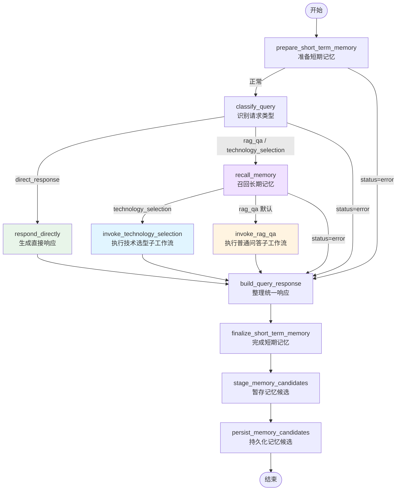
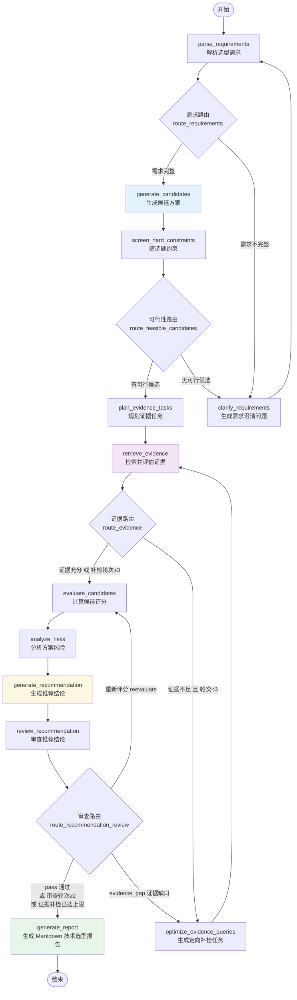

# RAG Agent 工作流程图

> 依据 `src/workflows/*.py` 中的真实节点、边与路由函数梳理（langgraph StateGraph）。
> 配置上限：改写 2 次 / 生成重试 2 次 / 证据补检 3 轮 / 审查 2 轮（`src/config/config.yaml`）。

## 目录

1. [主路由工作流（Query Router Graph）](#1-主路由工作流)
2. [普通问答工作流（RAG QA Graph）](#2-普通问答工作流)
3. [技术选型工作流（Technology Selection Graph）](#3-技术选型工作流)
4. [节点清单](#4-节点清单)
5. [边与路由决策清单](#5-边与路由决策清单)

---

## 1. 主路由工作流

定义：`src/workflows/query_router_graph.py`，状态：`query_router_state.py`。
生产环境（`open_memory_application`）启用长期记忆，含 recall_memory / stage_memory_candidates / persist_memory_candidates 三个记忆节点。



**说明**

- 入口即准备短期记忆；任何节点报错（status=error）都会短路到 `build_query_response` 直接产出错误响应。
- 不启用长期记忆时（`memory_repository=None`），`classify_query` 直接按 `route_by_query_type` 路由到三个子工作流，且 `finalize_short_term_memory → END`。
- 子工作流执行完毕后统一回到 `build_query_response` 组装响应。

---

## 2. 普通问答工作流

定义：`src/workflows/rag_qa_graph.py`，状态：`rag_qa_state.py`。

```mermaid
graph TD
    START([开始]) --> entry{入口路由<br/>route_rag_qa_entry}
    entry -->|"source_preference=web"| web[web_search<br/>联网检索]
    entry -->|"默认 auto"| analyze[analyze_question<br/>分析问题]

    analyze --> after{分析后路由<br/>route_after_analysis}
    after -->|"local / local_hybrid"| vec[vector_retrieve<br/>向量检索 Milvus]
    after -->|"local / local_hybrid"| graph[graph_retrieve<br/>图谱检索 Neo4j]
    after -->|"web_search"| web

    vec --> merge[merge_retrieval_results<br/>融合检索结果]
    graph --> merge
    merge --> grade[grade_documents<br/>筛选相关证据]

    grade --> decide{证据决策<br/>decide_to_generate}
    decide -->|"有相关文档"| gen[generate<br/>生成回答]
    decide -->|"无文档 且 改写次数&lt;2"| transform[transform_query<br/>改写查询]
    decide -->|"无文档 且 改写≥2<br/>或本地检索全部失败"| web

    transform --> extract[extract_retrieval_intent<br/>抽取检索意图]
    extract --> vec
    extract --> graph

    web --> gen

    gen --> eval{生成评估<br/>grade_generation_v_documents_and_question}
    eval -->|"有依据 且 回答了问题"| END1([结束])
    eval -->|"检索失败"| END1
    eval -->|"有依据但未答 且 改写&lt;2"| transform
    eval -->|"有依据但未答 且 改写≥2<br/>或来源为联网"| web
    eval -->|"无依据 且 生成重试&lt;2"| gen
    eval -->|"无依据 且 生成重试≥2"| web

    style vec fill:#e8f5e9
    style graph fill:#e8f5e9
    style gen fill:#fff9c4
    style web fill:#ffe0b2
```

**说明**

- **并行检索**：`local` / `local_hybrid` 时 `vector_retrieve` 与 `graph_retrieve` 并行执行，共同汇入 `merge_retrieval_results`；`extract_retrieval_intent` 同样扇出到两个检索器。
- **证据决策**：无相关文档时先改写查询重试（上限 2 次），达到上限或本地检索器全部故障则转联网搜索。
- **生成评估**：幻觉评估（是否基于证据）+ 问题解决评估（是否回答提问）；未通过时按「重写 / 重生成 / 联网」有界修复。

---

## 3. 技术选型工作流

定义：`src/workflows/technology_selection_graph.py`，状态：`technology_selection_state.py`。



**说明**

- **需求闭环**：需求不完整时生成澄清问题并回到 `parse_requirements` 重新解析；硬约束筛选后无可行候选也回到澄清。
- **证据闭环**：证据不足时生成定向补检任务，回到 `retrieve_evidence`（上限 3 轮）。
- **审查闭环**：审查发现证据缺口 → 定向补检；要求重新评分 → `evaluate_candidates`；通过或轮次耗尽 → 生成报告。

---

## 4. 节点清单

### 4.1 主路由节点（10 个）

| 节点 | 作用 | 来源文件 |
|---|---|---|
| prepare_short_term_memory | 准备短期记忆 | `nodes/short_term_memory.py` |
| classify_query | 识别请求类型（rag_qa / technology_selection / direct_response） | `nodes/query_router.py` |
| recall_memory | 召回长期记忆（精确+语义） | `nodes/memory.py` |
| invoke_rag_qa | 执行普通问答子工作流 | `nodes/query_router.py` |
| invoke_technology_selection | 执行技术选型子工作流 | `nodes/query_router.py` |
| respond_directly | 直接响应（无需检索） | `nodes/query_router.py` |
| build_query_response | 整理统一响应 | `nodes/query_router.py` |
| finalize_short_term_memory | 完成短期记忆 | `nodes/short_term_memory.py` |
| stage_memory_candidates | 暂存记忆候选 | `nodes/memory.py` |
| persist_memory_candidates | 持久化记忆候选 | `nodes/memory.py` |

### 4.2 普通问答节点（9 个）

| 节点 | 作用 | 模型调用 | 来源文件 |
|---|---|---|---|
| analyze_question | 分析问题、判断检索策略 | 1（可复用 analysis_ready） | `nodes/analyze_question.py` |
| extract_retrieval_intent | 抽取检索意图 | 1 | `nodes/analyze_question.py` |
| web_search | 联网检索 | 1 | `nodes/web_search.py` |
| vector_retrieve | 向量检索（Milvus） | 0 | `nodes/retrieve.py` |
| graph_retrieve | 图谱检索（Neo4j） | 0 | `nodes/graph_retrieve.py` |
| merge_retrieval_results | 融合两类检索结果 | 0 | `nodes/merge_retrieval_results.py` |
| grade_documents | 证据相关性筛选 | 1 | `nodes/grade_documents.py` |
| generate | 生成回答 | 1 | `nodes/generate.py` |
| transform_query | 改写查询 | 1 | `nodes/transform_query.py` |

### 4.3 技术选型节点（12 个）

| 节点 | 作用 | 来源文件 |
|---|---|---|
| parse_requirements | 解析选型需求 | `nodes/selection_requirements.py` |
| clarify_requirements | 生成需求澄清问题 | `nodes/selection_requirements.py` |
| generate_candidates | 生成候选方案 | `nodes/selection_requirements.py` |
| screen_hard_constraints | 硬约束筛选 | `nodes/selection_requirements.py` |
| plan_evidence_tasks | 规划证据检索任务 | `nodes/selection_evidence.py` |
| retrieve_evidence | 检索并评估证据（含并发上限 2） | `nodes/selection_evidence.py` |
| optimize_evidence_queries | 生成定向补检任务 | `nodes/selection_evidence.py` |
| evaluate_candidates | 计算候选评分 | `nodes/selection_decision.py` |
| analyze_risks | 分析方案风险 | `nodes/selection_decision.py` |
| generate_recommendation | 生成推荐结论 | `nodes/selection_decision.py` |
| review_recommendation | 审查推荐结论 | `nodes/selection_decision.py` |
| generate_report | 生成 Markdown 技术选型报告 | `nodes/selection_decision.py` |

---

## 5. 边与路由决策清单

### 5.1 主路由（`query_router_graph.py`）

| 起点 | 终点 | 条件 |
|---|---|---|
| START | prepare_short_term_memory | 固定边 |
| prepare_short_term_memory | classify_query / build_query_response | `_route_after_short_term_prepare`：error→build，否则→classify |
| classify_query | recall_memory / respond_directly / build_query_response | `_route_to_memory_or_response`：direct_response→respond；error→build；其余→recall |
| recall_memory | invoke_rag_qa / invoke_technology_selection / build_query_response | `_route_after_memory`：technology_selection→选型；error→build；默认→问答 |
| invoke_rag_qa / invoke_technology_selection / respond_directly | build_query_response | 固定边（汇合） |
| build_query_response | finalize_short_term_memory | 固定边 |
| finalize_short_term_memory | stage_memory_candidates / END | 启用记忆→stage；否则→END |
| stage_memory_candidates | persist_memory_candidates | 固定边 |
| persist_memory_candidates | END | 固定边 |

> 无记忆变体：`classify_query` 走 `route_by_query_type`，直接路由到 invoke_rag_qa / invoke_technology_selection / respond_directly / build_query_response。

### 5.2 普通问答（`rag_qa_graph.py`）

| 起点 | 终点 | 条件 |
|---|---|---|
| START | analyze_question / web_search | `route_rag_qa_entry`：source_preference=web→web_search，否则→analyze |
| analyze_question | vector_retrieve + graph_retrieve（并行） / web_search | `route_after_analysis`：local 或 local_hybrid→双路并行；web_search→web |
| vector_retrieve / graph_retrieve | merge_retrieval_results | 固定边 |
| merge_retrieval_results | grade_documents | 固定边 |
| grade_documents | generate / transform_query / web_search | `decide_to_generate`：有文档→generate；无文档且改写<2→transform；无文档且改写≥2 或双检索器故障→web |
| web_search | generate | 固定边 |
| generate | END / transform_query / web_search / generate | `grade_generation_v_documents_and_question`：检索失败→END；有依据且答→END；有依据未答且改写<2→transform；有依据未答且改写≥2 或来自联网→web；无依据且重试<2→generate（重生成）；无依据且重试≥2→web |
| transform_query | extract_retrieval_intent | 固定边 |
| extract_retrieval_intent | vector_retrieve + graph_retrieve（并行） | 固定边扇出 |

### 5.3 技术选型（`technology_selection_graph.py`）

| 起点 | 终点 | 条件 |
|---|---|---|
| START | parse_requirements | 固定边 |
| parse_requirements | generate_candidates / clarify_requirements | `route_requirements`：requirements_complete→生成候选；否则→澄清 |
| clarify_requirements | parse_requirements | 固定边（需求闭环） |
| generate_candidates | screen_hard_constraints | 固定边 |
| screen_hard_constraints | plan_evidence_tasks / clarify_requirements | `route_feasible_candidates`：有可行候选→证据规划；无→澄清 |
| plan_evidence_tasks | retrieve_evidence | 固定边 |
| retrieve_evidence | evaluate_candidates / optimize_evidence_queries | `route_evidence`：证据充分 或 轮次≥3→评分；否则→补检 |
| optimize_evidence_queries | retrieve_evidence | 固定边（证据闭环，上限 3 轮） |
| evaluate_candidates | analyze_risks | 固定边 |
| analyze_risks | generate_recommendation | 固定边 |
| generate_recommendation | review_recommendation | 固定边 |
| review_recommendation | generate_report / optimize_evidence_queries / evaluate_candidates | `route_recommendation_review`：pass→报告；证据缺口→补检；重新评分→evaluate；审查轮次≥2 或补检达上限→强制报告 |
| generate_report | END | 固定边 |

---

## 关键特性

1. **三层图结构**：主路由图嵌套普通问答图与技术选型图两个子图。
2. **多轮有界迭代**：改写（2）、生成重试（2）、证据补检（3）、审查（2）均有上限。
3. **并行检索**：向量（Milvus）+ 图谱（Neo4j）双路并行后融合。
4. **记忆机制**：短期记忆（会话）+ 长期记忆（持久化，含记忆候选暂存）。
5. **错误短路**：任何节点 error 状态直接汇入 `build_query_response` 输出错误响应。
